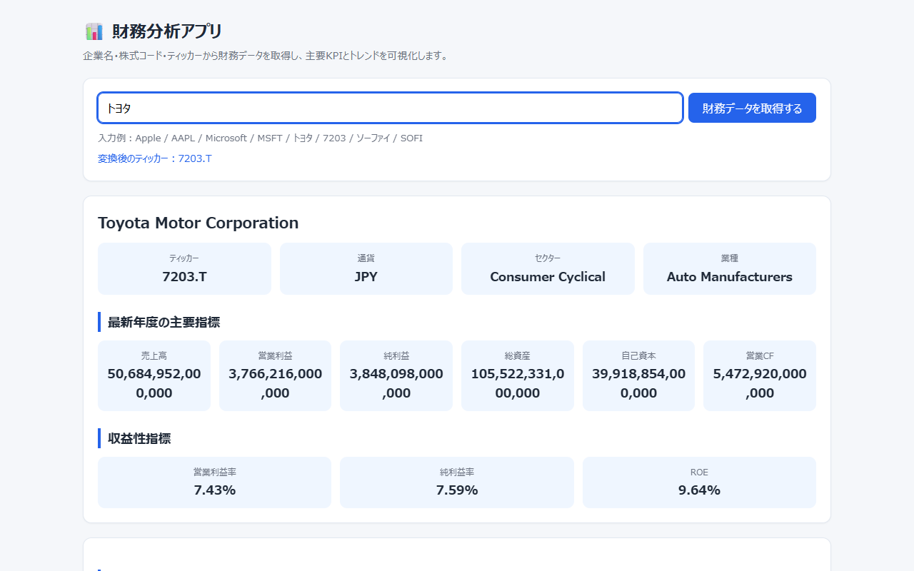
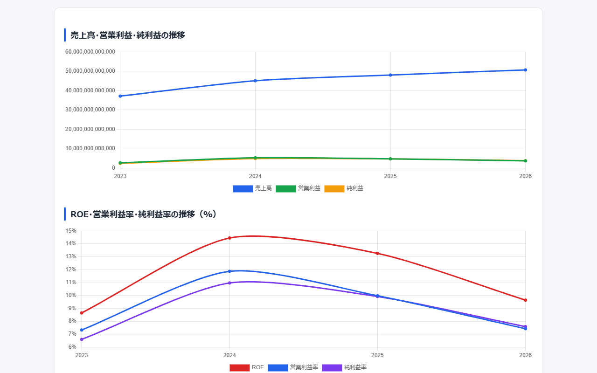
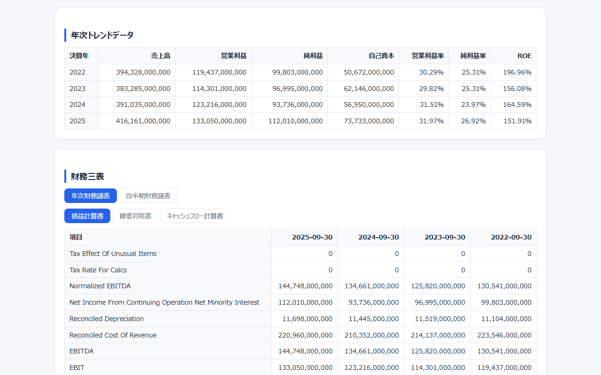

# 財務分析アプリ（Financial Analysis App）

企業分析の学習を想定した Django アプリです。企業名・株式コード・ティッカーを入力すると、yfinance で財務データを取得し、最新年度の主要指標、収益性指標の推移グラフ、財務三表を 1 画面に表示します。「トヨタ」「Apple」のような社名や「7203」のような 4 桁の株式コードでも検索できます。


> **English summary:** A Django web app that looks up a company by name, Tokyo Stock Exchange code or ticker symbol (e.g. "トヨタ", "7203", "AAPL"), fetches its financial statements from Yahoo Finance via yfinance, and shows key metrics (revenue, operating income, net income, total assets, equity, operating cash flow), profitability ratios (operating margin, net margin, ROE), trend charts and the annual/quarterly income statement, balance sheet and cash-flow statement on a single page. It is a Django port of the Streamlit app (`app.py`) that is kept in this repository for reference.

<p align="center">
  
</p>

## 目次

- [主な機能](#主な機能)
- [クイックスタート](#クイックスタート)
- [使い方](#使い方)
- [技術スタック](#技術スタック)
- [プロジェクト構成](#プロジェクト構成)
- [設計のポイント](#設計のポイント)
- [テスト](#テスト)
- [本番環境で使うとき](#本番環境で使うとき)
- [ロードマップ](#ロードマップ)
- [既知の制限](#既知の制限)
- [データと免責](#データと免責)

## 主な機能

- **入力の自動変換**：登録済みの社名（日本語・英語）をティッカーに変換し、4 桁の数字には東京証券取引所を表す `.T` を付けます。それ以外の入力は大文字のティッカーとして扱います。
- **主要指標**：最新年度の売上高・営業利益・純利益・総資産・自己資本・営業キャッシュフローと、営業利益率・純利益率・ROE を表示します。
- **トレンドグラフ**：年次の売上高・営業利益・純利益と、ROE・営業利益率・純利益率の推移を Chart.js の折れ線グラフで表示します。
- **財務三表**：損益計算書・貸借対照表・キャッシュフロー計算書を、年次と四半期のタブで切り替えて表示します。主な項目名は日本語に訳します。
- **共有できる URL**：検索は GET（`/?query=トヨタ`）で送るため、結果の URL をブックマークや共有に使えます。
- **分かりやすいエラー表示**：未入力、存在しないティッカー、通信エラーなどの場合に、画面に日本語のメッセージを表示します。

## クイックスタート

前提：

- Python 3.13 で動作確認しています（`requirements.txt` の `Django>=5.2` は Python 3.10 以上が必要です）。
- 財務データの取得に、インターネット接続（Yahoo Finance へのアクセス）が必要です。

### Windows（PowerShell）

```powershell
git clone https://github.com/rebelnaoto7/financial_analysis_app.git
cd financial_analysis_app
python -m venv .venv
.\.venv\Scripts\Activate.ps1
pip install -r requirements.txt
python manage.py runserver
```

`Activate.ps1` の実行がブロックされた場合は、`Set-ExecutionPolicy -Scope Process -ExecutionPolicy RemoteSigned` を実行してから、もう一度有効化してください（今開いている PowerShell だけに適用されます）。

### macOS / Linux

```bash
git clone https://github.com/rebelnaoto7/financial_analysis_app.git
cd financial_analysis_app
python3 -m venv .venv
source .venv/bin/activate
pip install -r requirements.txt
python manage.py runserver
```

起動したら、ブラウザで <http://127.0.0.1:8000/> を開きます。ポート 8000 が使用中のときは、`python manage.py runserver 8001` のようにポート番号を指定してください。

> [!NOTE]
> 分析画面を使うだけなら `python manage.py migrate` は不要です。起動時に `You have 18 unapplied migration(s).` のような警告が出ますが、分析画面の動作には影響しません。`runserver` を実行すると、プロジェクト直下に空の `db.sqlite3` が作られます（`.gitignore` で除外済み）。

Django の管理画面（`/admin/`）を使う場合は、データベースを作成して管理ユーザーを登録します（コマンドは Windows と macOS / Linux で共通です）。

```bash
python manage.py migrate
python manage.py createsuperuser
```

## 使い方

1. 入力欄に企業名・株式コード・ティッカーを入れて、「財務データを取得する」を押します（Enter キーでも送信できます）。
2. 「変換後のティッカー」に続いて、会社情報（ティッカー・通貨・セクター・業種）、最新年度の主要指標、収益性指標が表示されます。1 回の検索には数秒かかります。
3. 下にスクロールすると、トレンドグラフ、年次トレンドデータの表、財務三表が表示されます。

<p align="center">
  
</p>

<p align="center">
  
</p>

### 入力の解釈

| 入力の例 | 解釈 | 検索するティッカー |
| --- | --- | --- |
| `トヨタ`、`Apple`、`ソーファイ` | 登録済みの社名（下の表） | `7203.T`、`AAPL`、`SOFI` |
| `7203` | 4 桁の数字は東証の株式コード | `7203.T` |
| `aapl`、`7203.T` | それ以外はティッカーとして大文字に変換 | `AAPL`、`7203.T` |

社名は次の 15 社を登録しています。前後の空白と英字の大文字・小文字の違いは無視しますが、表記は完全に一致させる必要があります。

| ティッカー | 入力できる社名 |
| --- | --- |
| AAPL | apple、アップル |
| MSFT | microsoft、マイクロソフト |
| NVDA | nvidia、エヌビディア |
| AMZN | amazon、アマゾン |
| GOOGL | google、alphabet、グーグル |
| META | meta、facebook、メタ |
| TSLA | tesla、テスラ |
| SOFI | sofi、sofi technologies、ソーファイ |
| 7203.T | トヨタ、トヨタ自動車、toyota、toyota motor |
| 6758.T | ソニー、ソニーグループ、sony |
| 7974.T | 任天堂、nintendo |
| 9984.T | ソフトバンク、ソフトバンクグループ、softbank |
| 6861.T | キーエンス、keyence |
| 8306.T | 三菱ufj、mufg |
| 9432.T | ntt、日本電信電話 |

### 確認した検索例（2026年11月）

| 入力 | 変換後のティッカー | 結果 |
| --- | --- | --- |
| `AAPL`、`Apple`、`aapl` | AAPL | Apple Inc.（USD、トレンド 2022〜2025 年） |
| `Microsoft` | MSFT | Microsoft Corporation（USD、トレンド 2023〜2026 年） |
| `7203`、`トヨタ` | 7203.T | Toyota Motor Corporation（JPY、トレンド 2023〜2026 年） |
| `ソーファイ` | SOFI | SoFi Technologies, Inc.（USD、トレンド 2022〜2025 年。営業利益は N/A） |
| `ZZZZZZZZ`、`12345` | ZZZZZZZZ、12345 | 「財務データを取得できませんでした。ティッカーが正しいか確認してください。」 |
| 空欄、空白のみ | なし | 「企業名・株式コード・ティッカーを入力してください。」 |

### 表示の見方

- 金額は、報告通貨（USD・JPY など）の値を単位を変えずに表示します。例えばトヨタの売上高 50,684,952,000,000 は約 50.7 兆円です。
- 「最新年度」は、年次データのうち最も新しい決算期です。トレンドの「決算年」は決算期末日の西暦年で、例えばトヨタの「2026」は 2026 年 3 月期です。
- 営業利益率 ＝ 営業利益 ÷ 売上高、純利益率 ＝ 純利益 ÷ 売上高、ROE ＝ 純利益 ÷ 期末の自己資本 です。自己資本が小さい企業では、ROE が 100% を超えることがあります（2026年11月の確認時、Apple の最新年度の ROE は 151.91%）。
- 財務三表には yfinance が返す項目をすべて表示し、主な 27 項目（売上高・営業利益・総資産・営業キャッシュフローなど）を日本語に訳します。それ以外の項目名は英語のままです。
- 値を取得できない指標は「N/A」、データがない表は「データはありません。」と表示します。

## 技術スタック

| 分類 | 使用技術 |
| --- | --- |
| 言語・フレームワーク | Python 3.13、Django（`requirements.txt` は `>=5.2`。動作確認は 6.1.2） |
| データ取得 | yfinance（動作確認は 1.7.0） |
| データ処理 | pandas |
| グラフ | Chart.js 4.4.1（`analyzer/static/` に同梱。CDN は使いません） |
| 画面 | Django テンプレート、CSS と素の JavaScript（外部の CSS フレームワークなし） |
| データベース | SQLite（Django の管理画面を使う場合のみ） |

設定の `TIME_ZONE = "Asia/Tokyo"` を Windows でも使えるように、`requirements.txt` ではタイムゾーンのデータ `tzdata` を Windows のときだけインストールするよう指定しています。

## プロジェクト構成

```text
financial_analysis_app/
├── manage.py
├── requirements.txt
├── README.md
├── app.py                       # 移植元の Streamlit 版（参考用）
├── trades.csv                   # アプリでは使っていない CSV（見出し行のみ）
├── config/                      # プロジェクト設定
│   ├── __init__.py
│   ├── settings.py
│   ├── urls.py                  # /admin/ と analyzer の URL
│   ├── asgi.py
│   └── wsgi.py
├── analyzer/                    # アプリ本体
│   ├── __init__.py
│   ├── apps.py
│   ├── forms.py                 # 検索フォーム（GET の query）
│   ├── models.py                # モデルなし
│   ├── urls.py
│   ├── views.py                 # 入力の受け取りと画面の表示
│   ├── services/
│   │   ├── __init__.py
│   │   └── finance.py           # ティッカー解決・データ取得・指標計算（Django に依存しない）
│   ├── static/analyzer/js/
│   │   └── chart.umd.min.js     # Chart.js 4.4.1
│   └── templates/analyzer/
│       └── index.html           # 画面（CSS と JavaScript を含む）
└── docs/
    ├── DEVELOPMENT.md           # 開発者向けメモ（移植対応表・指標の定義）
    └── images/                  # README 用のスクリーンショット
```

| URL | 内容 |
| --- | --- |
| `/` | 分析画面（`?query=` に入力値を付けると検索結果を表示） |
| `/admin/` | Django の管理画面（`migrate` と管理ユーザーの登録が必要） |

### Streamlit 版（app.py）について

`app.py` は、このアプリの移植元の Streamlit 版です。Django 版と同じ画面構成で、取得結果を `st.cache_data` でキャッシュします。`requirements.txt` には Streamlit が含まれていないため、動かす場合は仮想環境を有効にした状態で別にインストールします（コマンドは Windows と macOS / Linux で共通です）。

```bash
pip install streamlit
streamlit run app.py
```

既定では <http://localhost:8501/> で開きます。Streamlit 1.66.1 で、起動と「トヨタ」の検索ができることを確認しました（2026年11月）。検索時のログに `use_container_width` が非推奨であるという警告が出ますが、表示には影響しません。

## 設計のポイント

- **ロジックと画面の分離**：ティッカーの解決、データ取得、指標の計算、表示用の整形は `analyzer/services/finance.py` にまとめています。このファイルは pandas と yfinance だけを使い、Django に依存しません。ビューは入力を受け取り、`analyze()` の結果をテンプレートに渡すだけです。
- **yfinance の遅延インポート**：yfinance はデータを取得するときに初めて読み込みます。そのため、yfinance がなくても `manage.py check` や画面の表示は動き、検索したときに「yfinance がインストールされていません。…」と表示します。
- **エラーの集約**：取得や計算で起きたエラーは `AnalysisError` にまとめ、ビューで画面のメッセージとして表示します。
- **グラフ用データの受け渡し**：トレンドのデータは Django の `json_script` フィルターでページに埋め込み、JavaScript から読み込んで Chart.js に渡します。
- **CDN なしで動く画面**：Chart.js をリポジトリに同梱しているため、ブラウザは外部のサーバーにアクセスしません（データ取得はサーバー側で行います）。

Streamlit 版との対応表と指標の定義は、[docs/DEVELOPMENT.md](docs/DEVELOPMENT.md) にまとめています。

## テスト

自動テストはまだありません（`python manage.py test` の結果は `Ran 0 tests` / `NO TESTS RAN`）。公開前の確認として、次のことを実際に行いました。

```powershell
python manage.py check           # System check identified no issues (0 silenced).
python manage.py check --deploy  # 本番向け設定の警告が 6 件（「本番環境で使うとき」を参照）
python manage.py migrate         # 18 件のマイグレーションをすべて適用
```

- HTTP での確認：`/` と `/?query=7203` が 200、`/static/analyzer/js/chart.umd.min.js` が 200 で配信されること。
- 検索：[確認した検索例](#確認した検索例2026年11月)の入力で、表のとおりの結果とメッセージが表示されること。101 文字以上の入力では「この値は 100 文字以下でなければなりません」と表示されること。
- エラー処理：yfinance をアンインストールしても `check` と画面の表示は動き、検索すると「yfinance がインストールされていません。…」と表示されること。通信エラーを模擬すると「データ取得中にエラーが発生しました: …」と表示されること。
- ブラウザでの操作：Chart.js 4.4.1 が読み込まれて 2 つのグラフが描画されること、年次・四半期と三表のタブが切り替わること、ブラウザから外部へのリクエストがないこと。
- 管理画面：`migrate` と `createsuperuser` のあと、`/admin/` にログインできること。
- Streamlit 版：`streamlit run app.py` で起動し、「トヨタ」の検索結果が表示されること。

動作確認環境：Windows 11 / Python 3.13 / Django 6.1.2 / pandas 3.1.0 / yfinance 1.7.0 / Microsoft Edge（2026年11月）。macOS / Linux のコマンドは標準的な手順を記載しており、実機では確認していません。

## 本番環境で使うとき

このリポジトリの設定は開発用です。`config/settings.py` は環境変数を読まないため、公開する前に設定ファイルを書き換えてください。

| 設定 | 現在の値 | 公開時の対応 |
| --- | --- | --- |
| `SECRET_KEY` | 開発用の固定値 | 環境変数などから読み込む形に変え、推測できない値にする |
| `DEBUG` | `True` | `False` にする |
| `ALLOWED_HOSTS` | `["127.0.0.1", "localhost"]` | 公開するドメインを指定する |
| `STATIC_ROOT` | 未設定 | 設定してから `python manage.py collectstatic` を実行する |

- Chart.js は static ファイルとして配信します。`DEBUG = False` では Django は static ファイルを配信しないため、`collectstatic` で集めたファイルを Web サーバーなどから配信しないと、グラフが表示されません。なお、`STATIC_ROOT` が未設定のまま `collectstatic` を実行するとエラーになります。
- `python manage.py check --deploy` では、HTTPS 関連（`SECURE_HSTS_SECONDS`・`SECURE_SSL_REDIRECT`・`SESSION_COOKIE_SECURE`・`CSRF_COOKIE_SECURE`）と `SECRET_KEY`・`DEBUG` について、合計 6 件の警告が出ます。
- 取得結果をキャッシュしないため、アクセスのたびに Yahoo Finance へリクエストを送ります。公開する場合は、キャッシュやアクセス数の制限を検討してください。
- `runserver` は開発用のサーバーです。公開する場合は WSGI サーバー（エントリーポイントは `config/wsgi.py`）を使ってください。

## ロードマップ

| 状態 | 内容 |
| --- | --- |
| 🚧 | 取得結果のキャッシュ（Django のキャッシュ機能（LocMem・Redis など）で同じティッカーの再取得を減らす。Streamlit 版の `st.cache_data` に相当） |
| 🚧 | 社名の入力候補の表示（登録済みの社名一覧 `COMPANY_ALIASES` を使ったオートコンプリート） |
| 🚧 | ログインとお気に入り銘柄（ウォッチリスト）の保存（`models.py` にモデルを追加） |

## 既知の制限

- データの取得は yfinance と Yahoo Finance に依存します。Yahoo Finance 側の仕様変更、短時間に多数のリクエストを送ったときのレート制限、ネットワークの制限などで、取得に失敗することがあります。その場合は「データ取得中にエラーが発生しました: （エラーの内容）」または「財務データを取得できませんでした。…」と表示されます。2026年11月の確認では、上の検索例はすべて取得でき、レート制限は発生しませんでした。
- 取得結果をキャッシュしないため、同じ企業でも検索のたびにデータを取得し直します。
- 社名で検索できるのは登録済みの 15 社だけです。例えば「トヨタ自動車株式会社」は変換されないため、データを取得できません。
- 株式コードは半角数字 4 桁で入力してください。全角数字（例：`７２０３`）は `７２０３.T` に変換されてしまい、データを取得できません。英字を含む新しい形式の証券コードには `.T` が付かないため、`7203.T` と同じ形でティッカーを入力してください。
- 財務三表の値は小数点以下を丸めて整数で表示するため、EPS（1 株当たり利益）や税率のような小さな値は正しく表示されません（例：Apple の「Tax Rate For Calcs」は 0.156 などの値が「0」と表示されます）。
- 金額の単位を換算しないため、桁数の多い金額は指標の欄の中で折り返して表示されます。
- 主な 27 項目以外の項目名は英語のままです。
- `trades.csv` は見出し行だけの CSV で、アプリのコードからは使われていません。
- 自動テストはまだありません。

## データと免責

- 財務データは、オープンソースのライブラリ yfinance を通じて Yahoo Finance から取得しています。yfinance は Yahoo とは関係のない非公式のツールです。データの利用は Yahoo の利用規約に従ってください。
- 表示する数値の正確性・完全性・最新性は保証しません。重要な判断の前には、各社の決算資料などの一次情報で確認してください。
- このアプリは学習と分析の補助を目的としたもので、投資助言ではありません。投資の判断はご自身の責任で行ってください。
